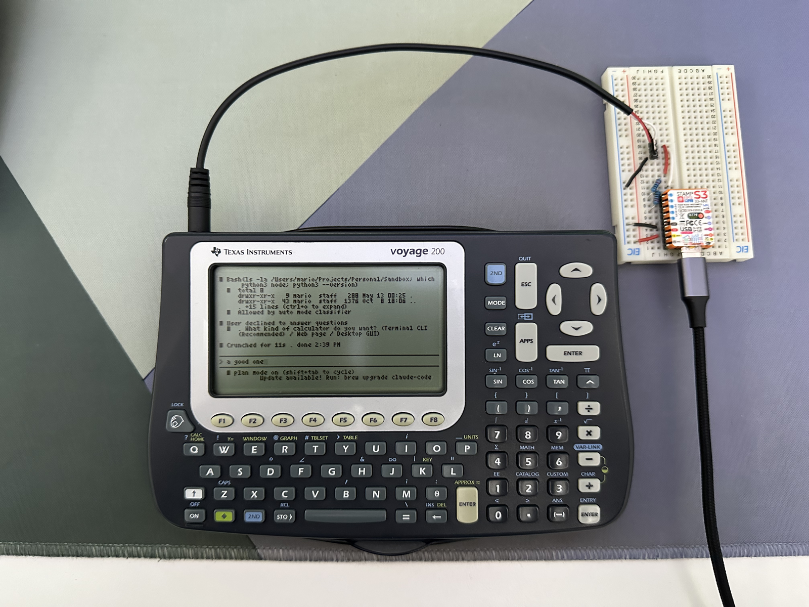
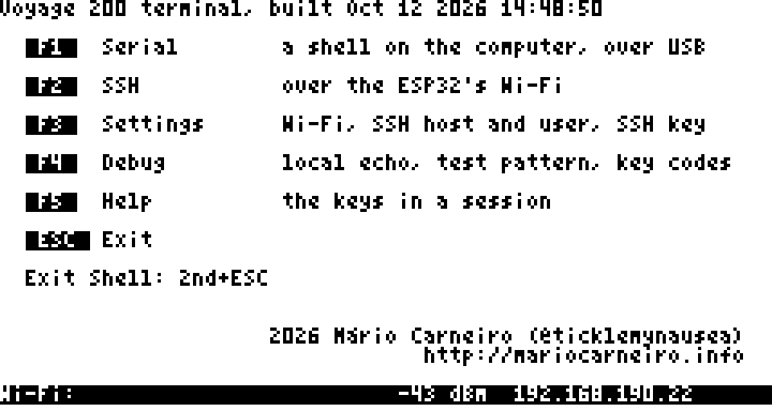
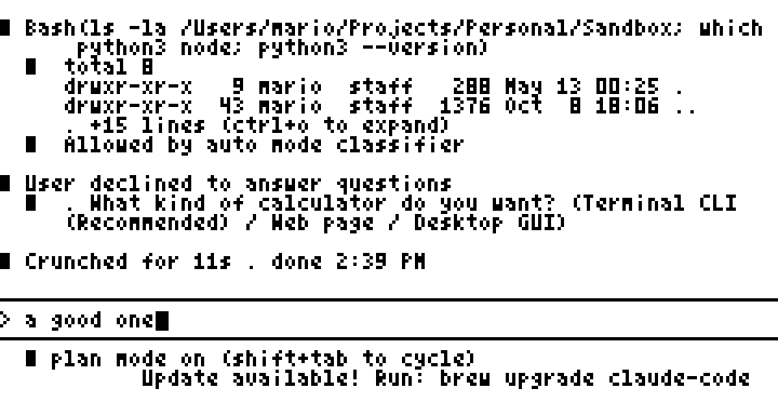
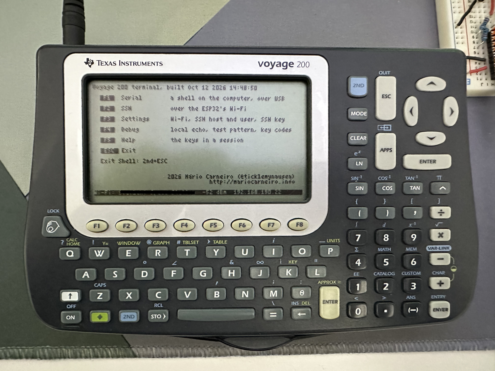
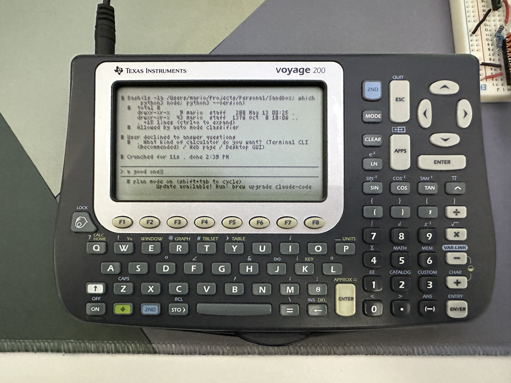
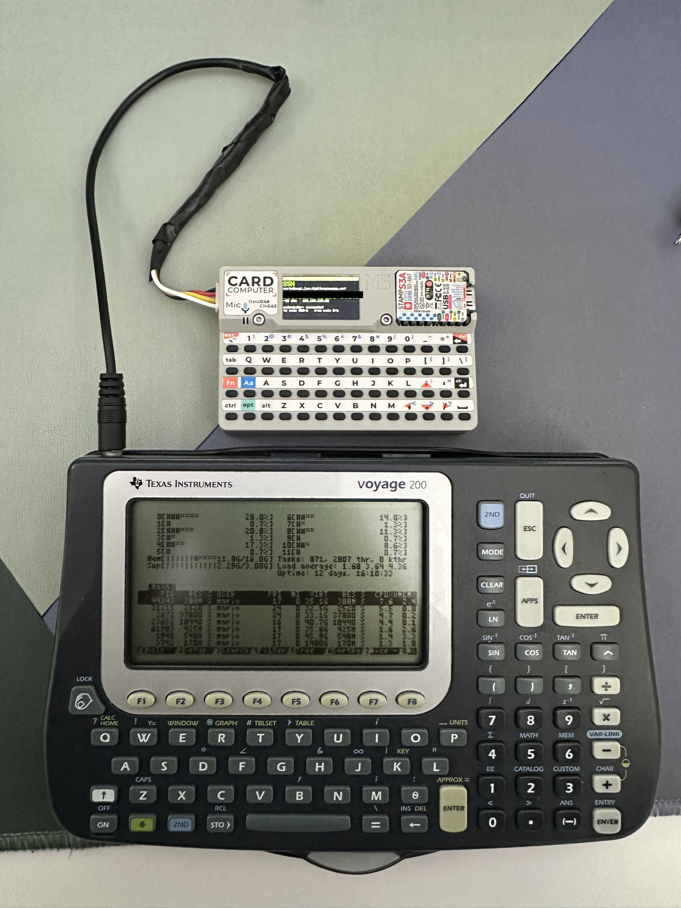

# TI Voyage 200 Terminal Link

**tl;dr**: makes a terminal-based cyberdeck out of a TI Voyage 200 calculator without any physical modifications to it

A **TI Voyage 200** graphing calculator as a terminal to real computers, and
the reverse engineering of its link port that led there. An ESP32 (Arduino
framework) sits on the calculator's 2.5 mm link port and does the networking;
the calculator draws the text and reads the keys. The ESP32 is either an
M5Stack Stamp S3 on a breadboard or an M5Stack Cardputer, whose battery and
screen make the setup portable.

## Demo videos

| Demo 1 | Demo 2 |
|---|---|
|  |  |

## What it does

A 13 KB C program turns the calculator into a 60x21 VT220 terminal. From its
menu you open:

- **Serial**: a shell on the computer the ESP32 is plugged into, over USB.
- **SSH**: a session to any host over Wi-Fi. The ESP32 keeps up to eight
  hosts and four Wi-Fi networks, and can make a key of its own and copy it
  to a host, so no password has to be typed on the calculator.

All the settings are made from the calculator's menus. 2nd + APPS sends the
calculator's screen to the computer as a screenshot.

Programs confirmed to work on it:

- `irssi`
- `nchat` - telegram and whatsapp
- `htop` and `top`
- `cmatrix`
- `links` web browser
- `vim` and `nvim`
- `claude` - Claude Code
- `tmux` and `screen`, which tie everything together in one terminal
  session ([settings for both](docs/tmux-and-screen.md))

## Screenshots and pictures

| The menu | Claude Code in a session |
|---|---|
|  |  |

These two are screenshots: the calculator sends its own screen through the
ESP32 when 2nd + APPS is pressed. The same two on the calculator:

| The menu | Claude Code in a session |
|---|---|
|  |  |

### With the Cardputer: no cables to anything else

The calculator runs on its own batteries and the Cardputer on its battery.
The only cable is the short one between the two; the session is SSH over
the Cardputer's Wi-Fi, here running `htop`. The Cardputer's screen shows
the bridge's status page.

## How it works

The ESP32 speaks the link port's two-wire handshake itself, bit by bit, and
carries the bytes in both directions in frames of its own, without TI's
packet protocol. Each frame is checked, acknowledged and sent again if it
was lost, so nothing arrives garbled, not even after the cable was
replugged. The menu's commands and the ESP32's answers go in frames of their
own kinds ([how the pieces talk](docs/terminal.md#how-the-pieces-talk)).

## What you need

- A TI Voyage 200 (the TI-89 / TI-92 Plus family should behave the same
  way, untested).
- An ESP32: an M5Stack Stamp S3 on a breadboard, or an M5Stack Cardputer.
- A 2.5 mm stereo (TRS) pigtail cable for the link port, and two 220 ohm
  resistors.
- A link cable for the computer (SilverLink), to send the program to the
  calculator.

The software to install and the quick start are in
[docs/getting-started.md](docs/getting-started.md); parts and wiring in
[docs/hardware.md](docs/hardware.md).

## Documentation

| Part | What it does | Read |
|---|---|---|
| **Getting started** | What to install, and the quick start: flash the ESP32, send the program, run `term()`. | [docs/getting-started.md](docs/getting-started.md) |
| **Calculator as a terminal** | The terminal program, the ESP32 bridge with SSH and stored Wi-Fi settings, and the script that joins a local shell to it. | [docs/terminal.md](docs/terminal.md) |
| **Hardware** | Parts, wiring, a wiring check sketch, building and flashing. | [docs/hardware.md](docs/hardware.md) |
| **tmux and screen** | Settings that fit several windows on the calculator's screen. | [docs/tmux-and-screen.md](docs/tmux-and-screen.md) |
| **ESP32 as a link partner** | The ESP32 speaks TI's packet protocol, posing as a CBL data logger or another calculator, so TI-BASIC's `Send`, `Get` and `SendCalc` talk to it. | [docs/link-partner.md](docs/link-partner.md) |
| **Calculator-to-calculator protocol** | The ESP32 listens passively between two Voyage 200s; twenty tests document what they say to each other. | [PROTOCOL.md](calc-to-calc-protocol-reversed/PROTOCOL.md), [its README](calc-to-calc-protocol-reversed/README.md) |
| **Manual tests** | Tests run by hand on the calculator and the ESP32, by feature. | [docs/manual-tests.md](docs/manual-tests.md) |
| **Repository** | The layout of the files, and the experiments that were removed. | [docs/repository.md](docs/repository.md) |

## Status

This is a hobby project and a record of experiments, not a finished product.
Treat the protocol notes as findings from these calculators, not as a
specification.

## Credits

- [ArTICL](https://github.com/KermMartian/ArTICL) by Christopher Mitchell, the
  Arduino TI linking library, for the pin conventions and approach.
- The [TIGCC documentation](http://tigcc.ticalc.org/doc/link.html) for the
  calculator's link functions and variable types.
- [TI calculator character sets](https://en.wikipedia.org/wiki/TI_calculator_character_sets)
  on Wikipedia for the TI-89/92/Voyage 200 character table.
- [GCC4TI](https://github.com/debrouxl/gcc4ti) / TIGCC, the C compiler for the
  calculator, and [TiLP](http://lpg.ticalc.org/prj_tilp/) for sending programs
  to it.
- [LibSSH-ESP32](https://github.com/ewpa/LibSSH-ESP32) by Ewan Parker, the
  libssh port the SSH sessions run on.
