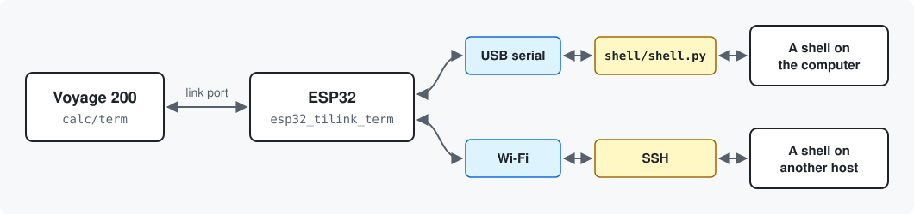

# The calculator as a terminal

The calculator is a dumb terminal: it draws characters, reads keys and moves
bytes over the link port, in checked frames of its own. TI's packet protocol
is not involved. The ESP32 carries the bytes to a shell, either on the
computer it is plugged into or on any host it can reach by SSH over Wi-Fi.



- **`calc/term/`** is the calculator program (about 13 KB), built with
  TIGCC / GCC4TI. It opens on a menu that picks where the session goes. It
  draws its own fixed-width 3x5 font, because the calculator's small font is
  proportional. The glyphs are drawn as text in `font.txt`. It handles the
  VT220 codes that shells and full-screen programs use: cursor movement,
  erasing, reverse video, scroll regions, inserting and deleting lines and
  characters. Text arrives as UTF-8; see [Characters](#characters) for what
  it can draw.
- **`esp32/esp32_tilink_term/`** carries the bytes to the backend the menu
  chose. `Ssh.h` / `Ssh.cpp` hold the SSH side, on the LibSSH-ESP32 library.
  On the serial side, its monitor mode shows what the calculator sends, and
  `/burst`, `/stats` and `/raw` test the link.
- **`shell/shell.py`** runs a command on the computer in a 60x21 `vt220`
  pseudo-terminal joined to the ESP32's port, for the menu's Serial entry.
- **`link/`** is the link layer between the calculator and the ESP32, in
  plain C that both build: frames, their checks, acknowledgements and
  resends. `make link:test` runs it on the computer, over a simulated line
  that garbles, drops, unplugs and slips.

## Running it

Needs `tigcc`, `python3`, `tilp` and `arduino-cli` on the PATH, and the SSH
library once: `arduino-cli lib install LibSSH-ESP32`. From the repo root:

```sh
make calc:term:send             # build term.v2z and send it (SilverLink cable)
make esp32_stamps3:term:flash   # compile and flash the bridge sketch (or esp32_cardputer:term:flash)
make shell                      # for the Serial entry: the login shell; or: make shell CMD=top
```

Move the calculator to the ESP32's pigtail and run `term()`. The menu:

| Key | Entry |
|---|---|
| F1 | Serial: the shell that `make shell` runs on the computer |
| F2 | SSH: a shell on one of the hosts in the settings, over Wi-Fi |
| F3 | Wi-Fi: picks which of the stored networks to use |
| F4 | Settings: a menu of its own, below |
| F5 | Debug: a menu of its own, below |
| F6 | Help: the keys and the menu, from `calc/term/help.txt` |
| ESC | Exit |

Settings:

| Key | Entry |
|---|---|
| F1 | Wi-Fi: sets, changes or removes one of the networks |
| F2 | SSH hosts: sets, changes or removes one of the hosts |
| F3 | SSH key: makes the ESP32's own key, replaces it or removes it |
| F4 | Copy the key: puts the public key on one of the hosts, after asking |

The ESP32 keeps up to eight SSH hosts, one for each of the keys F1 to F8.
SSH, SSH hosts and Copy the key first show them as a menu, where the F key
picks the host:

```
SSH

   F1   mario@server.example
   F2   pi@192.168.1.20:2222
   F3   -
   ...
   F8   -
   ESC  Back
```

A key with no host does nothing, except under SSH hosts, where it sets
one. The list is asked from the ESP32 each time the menu is shown.

Debug:

| Key | Entry |
|---|---|
| F1 | Local echo: nothing leaves the calculator |
| F2 | Test pattern, with the time a full screen takes |
| F3 | Key codes: shows each key's code |

ESC in any of them goes one menu back.

The menu's bottom row shows the Wi-Fi status, asked from the ESP32 every
three seconds: the network, signal strength and address, or that it is not
connected or not set up. The settings and debug menus show it too. An
entry that cannot be used has a checkered key and does not open:

- until the ESP32 answers ("asking the ESP32") or after it stops answering
  ("ESP32: no answer"), everything that goes through it: Serial, SSH,
  Wi-Fi and Settings in the main menu, all of the settings menu, and the
  keys of the host and network lists until the list has arrived;
- while Wi-Fi is not connected, the entries that need it: SSH, and Copy
  the key in Settings. Wi-Fi in the main menu joins a network.

Debug and Help always open. When it powers up, the ESP32 joins the network
it used last.

**A lost link in a session.** The calculator sends a short question
whenever it has sent nothing for 2 s, also while output is arriving, and
the ESP32 answers it, so each side keeps hearing the other. After 12 s with
nothing from the ESP32, the bottom row says `ESP32: no answer, check the link cable`
over whatever was there. When the ESP32 next sends something, the row goes
back to what it was and the session carries on. If the ESP32 has restarted
meanwhile, its session is gone, and the calculator says so:
`[ESP32 restarted, session lost: 2nd+ESC for the menu]`. The ESP32 can
also go quiet while it is busy: an SSH connection to a host that does not
answer takes 15 s to fail, so the row can show for a few seconds then.
Whether the SSH host is still there is a different question, which this
does not answer.

The ESP32 counts the calculator as there only while it hears the
calculator's own frames: its acknowledgements, its keys and its questions.
After 5 s without hearing it, the ESP32 sends it nothing until the
calculator speaks again. The session's output waits meanwhile, SSH's as
well as Serial's: unread, it holds the host back, so nothing is lost when
the cable is pulled, or while the symbol strip is open.

Nothing that crosses the link is lost or garbled: each frame is checked,
acknowledged, and sent again if it did not arrive, keys as well as output.
A byte under way when the cable comes out or goes back in can slip by a
bit, and then everything after it reads wrong; those frames fail their
check and are dropped. While slipped, the calculator's side of the link
cannot send, so its acknowledgements stop, and the ESP32 stops too. Once
the line has been still for a few seconds, the calculator's link hardware
drops the half byte, its next question gets through, and the ESP32 sends
again what was dropped. The output pauses for a few seconds and carries on
where it stopped.

If a menu still gets no answer, after three unanswered questions it resets
the calculator's side of the link, every 3 s until it has an answer, which
is what leaving `term()` and starting it again would do.

In a Serial session with `make shell`, three more cases are looked after:

- **The calculator away.** As above: the ESP32 stops reading what
  `make shell` sends. The script waits and the command is paused once its
  output piles up, so nothing is lost; it carries on when the cable is back.
- **The computer away.** If `make shell` was killed, its window closed or
  the computer went to sleep, the ESP32 hears nothing from it for 10 s and
  the calculator shows `[no answer from the computer: is make shell still
  running?]`, then `[the computer is answering again]` when it is back. A
  new `make shell` can be started at any time.
- **The ESP32 away.** If the ESP32's port goes away (unplugged, or it lost
  power), `make shell` says so and keeps the command running, and opens
  the port again when it comes back. What was on its way, at most 128
  bytes, is lost; Ctrl-L redraws the screen.

`make shell` can be started before or after choosing Serial: its output
waits until the calculator is in that session. Close the Serial Monitor
first: only one program can hold the ESP32's port.

`make shell MIRROR=1` shares the session with the window it runs in: the
output is copied there, and keys typed there go to the same shell, next to
the calculator's. Ctrl-C then goes to the shell like any other key, so
Ctrl-] is what stops it. Without `MIRROR`, the window shows nothing, sends
nothing, and Ctrl-C stops it.

For SSH, go through Settings first. Wi-Fi shows the stored networks, up
to four, and asks which one to set, change or remove. For a new or changed
one it lists the networks the ESP32 sees and asks for the network (by
number or name) and its password.

The ESP32 uses the network it joined last. Wi-Fi in the main menu shows
the stored networks, with the one that is joined or was used last marked,
and an F key joins that one, which then is the one used from now on,
across power cycles too. Before an SSH connection the ESP32 stays on a
stored network it has already joined. If it is on none, it tries the one
used last and then the others in their order, leaving out those a scan
does not show; if the scan shows none of them it tries them all, since one
may be hidden. A network joined that way becomes the one used last.

SSH
hosts, then an F key, asks for that host (`host` or `host:port`) and its
user; on a host that is already set it first offers to change or remove
it. They are stored in the ESP32's flash (the Preferences library), so they survive
power cycles and reflashing this sketch; another firmware put on the board
may erase them. The Wi-Fi passwords are readable there by
anyone holding the board. `/settings` in the Serial Monitor shows what is
stored, without the passwords. An ESP32 that had a single network or a
single host from before keeps it, as the first one.

**Logging in.** Without a key, the SSH password is asked for at every
connection and never stored. To skip it, the ESP32 can have a key of its
own:

1. Settings, F3 makes an ed25519 key pair on the ESP32 and shows its
   fingerprint. This talks to no host.
2. Settings, F4, then the host's F key, copies the public half to that
   host. It shows the
   fingerprint and the `user@host` it is about to change, and goes ahead
   only when `yes` is typed. It then logs in with the password once and
   adds a line ending in `voyage200` to `~/.ssh/authorized_keys` there.

From then on SSH to that host logs in with the key. There is one key for
all the hosts, and step 2 is done once for each host that should take it.
If a host refuses the key, the password is asked for as before. F3 also
replaces or removes the key; the hosts keep their line until it is deleted
there.

The private key never leaves the ESP32, and it is stored there unencrypted:
whoever holds the board can log in to the hosts that have its public half.
`/pubkey` in the Serial Monitor prints the public key line, to add to a
host by hand instead.

Each host's key is remembered at the first connection and checked
afterwards; if it changes, the connection is refused until `/forgethost 3`
(for the third host; without a number, all of them) is typed in the Serial
Monitor. Changing a host's name or port, or removing it, forgets its key
too.

## How the pieces talk

Everything between the calculator and the ESP32 goes in frames, made by the
link layer in `link/` (`tlink.h`), which both programs build. Between the
ESP32 and the computer the bytes are raw, with a few conventions built on
the byte `0x1E`, which neither a keyboard nor a shell normally produces.

**Frames.** `C0 | ctl | type | length | data | CRC | C0`, with the data at
most 128 bytes and the CRC (CRC-16/CCITT) two bytes, low byte first. `C0`
and `C1` never appear in UTF-8; when one of them is in a frame it goes as
`C1` and the byte xor `0x20`, so text hardly ever needs it. A frame that is
cut short, fails its CRC or has the wrong length is dropped, and the next
`C0` starts afresh, so garbage on the line never reaches the screen or the
shell.

`ctl` holds a sequence number, the acknowledgement (the number expected
next from the other side) and whether the frame is numbered. Numbered
frames arrive once each, in order: up to four can be on their way, and
when one does not arrive it is sent again, with the ones after it. The
sender does that at once if the other side has spoken since; if not, it
waits for it to speak, which gives a slipped link the quiet it needs.

| Type | Numbered | From | Data |
|---|---|---|---|
| ACK | no | both | none: only the acknowledgement |
| HELLO | no | calculator | the HELLO's number (2 bytes). Starts the link afresh, sent when `term()` starts and when a menu resets the link. A HELLO sent again because its answer was slow keeps its number, and the ESP32 only answers it again |
| HELLO_ACK | no | ESP32 | the number of the HELLO it answers, then the ESP32's two letters, picked at power-up. The calculator takes only the answer to its latest HELLO. Different letters mean the ESP32 has restarted |
| WHO | no | ESP32 | none. The answer to anything before a HELLO, which makes the calculator say HELLO again |
| PING | no | calculator | none. Sent after 2 s without sending; the ESP32 answers with ACK |
| DATA | yes | both | the session's bytes, as they are: keys, or the output |
| CMD | yes | calculator | a command letter, below, and for some a slot |
| STATUS | yes | ESP32 | the answer to `w`: `+` if Wi-Fi is connected or `-` if not, and a line of text |
| LIST | yes | ESP32 | one entry of the answer to `l` or `m`: the letter, the entry from 0, its text (empty if not set) |
| SHOT | yes | calculator | a screenshot, in 64 pieces: the piece number and 60 bytes of the screen |
| MEM | yes | calculator | its free memory, for the Cardputer's memory page: free RAM (`HeapAvail`), free handles, and from `EM_survey` the archive's free bytes, the bytes a garbage collection would free and the bytes in use, each least significant byte first. Sent every 5 s while nothing else waits to go, and at once after each HELLO_ACK. The archive is counted again only every minute, since that takes longer. `HeapMax` is not used: it compacts the heap each time |

The commands:

| Letter | Meaning |
|---|---|
| `s` | a Serial session starts |
| `h` | an SSH session with the host in the slot starts |
| `n` | the Wi-Fi settings dialog starts |
| `k` | the dialog for the host in the slot and its user starts |
| `g` | the SSH key dialog starts |
| `i` | the dialog that copies the key to the host in the slot starts |
| `j` | the Wi-Fi network in the slot is joined and used from now on |
| `x` | the session is over |
| `w` | what is the Wi-Fi status? |
| `l` | which are the SSH hosts? Answered with eight LIST entries, `user@host` (with `:port` if it is not 22) |
| `m` | which are the Wi-Fi networks? Answered with four, each a network's name, with a note if it is joined or was used last |

The slot is the host's or network's number, from 1. The output's bytes,
`0x1E`, `C0` and `C1` included, are drawn as they are: nothing in them is
taken for the ESP32. The calculator, the ESP32 and `link/` have to be
updated together.

**Computer to ESP32** (`shell/shell.py`). Three `0x1E` bytes, a word and a
newline switch the sketch's serial mode: `raw` or `monitor`. That works in
either mode, which matters when the script does not know which the ESP32 is
in. In raw mode entered that way the script keeps at most 128 bytes
outstanding, and the sketch answers `1E 'a'` for every 32 bytes it has
passed on. A real `0x1E` in the command's output is sent as `1E 'e'`, so
three in a row can only be a control line. It is not sent twice as in the
other direction because `1E 1E 1E` has to stay free for the control lines.
`1E 'k'` answers the sketch's question below.

**ESP32 to computer.** In that paced raw mode a real `0x1E` typed on the
calculator is sent twice, and a screenshot is `1E 'p'` and its 3840 bytes.
The sketch answers the `raw` line with `1E 'r'` and sends `1E 'b'` when it
starts. In a Serial session that has heard nothing from the script for 3 s
it asks `1E 'k'`, are you there?

Those two exist because monitor mode prints text meant for a person. A
script that believes the sketch is in raw mode would take that text for
keys typed on the calculator and hand it to the shell. So `shell/shell.py`
passes nothing on until it has seen `1E 'r'`, and when the ESP32 restarts
under it (`ESP-ROM:` from the boot loader, then `1E 'b'`) it asks for raw
mode again and waits. It also takes the port for itself, so a second copy
cannot switch the mode behind its back.

## Keys in a session

| Key | Sends |
|---|---|
| letters, digits, punctuation | themselves |
| ENTER | carriage return |
| backspace | DEL (code 127), which shells take as "erase one character" |
| ◆ + backspace (DEL) | Delete, which erases forwards (`ESC [ 3 ~`) |
| 2nd + backspace (INS) | Insert (`ESC [ 2 ~`) |
| ESC | Escape |
| arrows | the arrow keys |
| ◆ + letter | Ctrl + letter (the keyboard has no Ctrl key) |
| ◆ + space | Ctrl-Space (NUL, code 0) |
| APPS | Tab, in one key (◆ + I is Tab too) |
| ◆ + APPS | Shift-Tab (`ESC [ Z`), as 2nd + I |
| CLEAR | Ctrl-U, which erases the line in the shell |
| ◆ + CLEAR | Ctrl-L, after resetting this terminal as `ESC c` from the host would. For a screen left drawing lines or in reverse video by binary output, which Ctrl-L alone (◆ + L) only redraws in the same mess |
| LN | Ctrl-R, which searches the shell's history |
| 2nd + LN | Ctrl-_, undo in the shell and in emacs |
| ◆ + LN | Ctrl-\, which quits a program that Ctrl-C does not stop |
| ◆ + MODE | Ctrl-] |
| (−) | `-`, as the subtraction key |
| θ | `$` |
| 2nd + D / F / J (°, ∠, ∞) | `~` / `` ` `` / `%` |
| 2nd + ^ (π) / 2nd + × (√) | `` ` `` / `~` |
| 2nd + (−) (ANS) | Alt-. (`ESC .`): the last command's last argument in bash and zsh |
| 2nd + ENTER (ENTRY) | up, then ENTER: runs the last command again in the shell |
| SIN / COS | tmux: the previous / next window (Ctrl-B `p`, Ctrl-B `n`) |
| TAN | tmux's prefix, Ctrl-B (◆ + B too) |
| 2nd + SIN / COS / TAN | tmux: the list of windows / the window before this one / a new window (Ctrl-B `w`, `l`, `c`) |
| STO▸ / 2nd + STO▸ (RCL) | tmux: copy mode / paste what it copied (Ctrl-B `[`, `]`). In copy mode ◆ + up is a page back, and `q` leaves it |
| 2nd + 1 to 9 | tmux: windows 1 to 9 (Ctrl-B `1` to `9`). `tmux_calc.conf` numbers windows from 1 |
| ◆ + SIN / ◆ + COS | tmux: splits the window into two panes side by side / one above the other (Ctrl-B `%`, `"`) |
| ◆ + TAN | tmux: the other pane (Ctrl-B `o`) |
| 2nd + − (VAR-LINK) | tmux: the list of sessions (Ctrl-B `s`) |
| MODE, or shift + Hand | nothing itself: the next key goes out after an ESC, which is Alt + that key. Pressed again, it is called off |
| 2nd + I | Shift-Tab (`ESC [ Z`). Tab is ◆ + I, and shift cannot be added to that |
| ◆ + up / down | Page Up / Page Down |
| ◆ + left / right | Alt-B / Alt-F (`ESC b`, `ESC f`): a word back / forward in the shell. ESC then B or F does the same |
| Hand + arrows | Ctrl + arrows (`ESC [ 1 ; 5 A` and so on) |
| shift + arrows | Shift + arrows (`ESC [ 1 ; 2 A` and so on) |
| 2nd + up / down | Home / End (2nd + left / right too) |
| 2nd + plus (CHAR) | a symbol the keyboard lacks, picked from a strip on the bottom two rows |
| F1 to F8 | the function keys |
| ◆ + F1 to F4 | F9 to F12 |
| 2nd + ESC (QUIT) | nothing: goes back to the menu. ◆ + ESC does the same |
| 2nd + APPS | nothing: takes a [screenshot](#screenshots), in the menus too |

Any other key sends nothing. That covers the remaining TI-only characters,
such as ≠ or é. The divide key types `/`.

**Ctrl.** ◆ + a letter sends what Ctrl + that letter sends on a computer
keyboard, in either case. The ones used most:

| Key | Is | Usually does |
|---|---|---|
| ◆ + C | Ctrl-C | stops the running program |
| ◆ + D | Ctrl-D | ends the input; at an empty prompt, logs out |
| ◆ + Z | Ctrl-Z | suspends the running program |
| ◆ + L | Ctrl-L | clears or redraws the screen |
| ◆ + I | Ctrl-I | Tab: completes a name in the shell |
| ◆ + R | Ctrl-R | searches the shell's history |
| ◆ + A / ◆ + E | Ctrl-A / Ctrl-E | start / end of the line in the shell |

Ctrl with a symbol is mostly out of the usual reach. The program applies
the same rule to `[`, `\`, `]`, `^`, `_` and `@`, but the keyboard types most
of them only with 2nd, and ◆ + 2nd + a key sends nothing: tried with `]`,
which is 2nd + divide. So the ones in use have keys of their own: Ctrl-] is
◆ + MODE, Ctrl-\ is ◆ + LN, Ctrl-_ is 2nd + LN, and Ctrl-@ is ◆ + space.
`^` has a key, so ◆ + ^ is Ctrl-^ (8286). Ctrl-[ is not missed, since it is
the ESC key.

**Alt.** The keyboard has no Alt key, and a terminal sends Alt + a key as
ESC followed by that key. MODE, or shift + Hand, gives the next key that
ESC, in one go, so a program that waits only briefly after an ESC (vim, tmux) still
sees one key. It works with any key: MODE then `.` puts in the last
command's last argument in bash or zsh, then `d` deletes a word forward,
then backspace a word back. Nothing on the screen shows that it is waiting
for a key, since the OS's own indicators are kept off it (see the findings).
Hand alone cannot be the Alt key: with anything but an arrow it gives no
code at all. ESC and then the key does the same, as long as the program
does not take the ESC on its own first.

**Symbols.** 2nd + plus shows a strip on the bottom two rows with each
symbol next to a letter, `a` to `v`, drawn as a key in reverse video. The
letter picks the symbol, and any other key closes the strip. Here the keys
are in square brackets:

```
[ a ]~ [ b ]` [ c ]| [ d ]\ [ e ]$ [ f ]% [ g ]& [ h ]# [ i ]@ [ j ]_ [ k ]{
[ l ]} [ m ][ [ n ]] [ o ]< [ p ]> [ q ]' [ r ]" [ s ]; [ t ]: [ u ]! [ v ]?
```

**Arrows.** They send the usual codes (`ESC [ A` and so on). Programs such as
`less` and `vim` ask for the "application" codes instead (`ESC O A`), and
the arrows, Home and End switch to those until the program switches back.

**Shift-Tab.** 2nd + I sends `ESC [ Z`, which programs that read the keys
themselves (Claude Code for one) take as Shift-Tab. Programs built on
ncurses, such as nchat, do not: they look the key up in the terminal's
description, and `vt220` has no entry for it, inside tmux as well, since
`tmux_calc.conf` gives its programs the same description. Such a program
has to be told the sequence. For nchat that is
`prev_chat=\033\133\132` in `~/.config/nchat/key.conf`, edited while nchat
is not running.

**Function keys.** F1 to F4 send `ESC O P` to `ESC O S`; F5 to F8 send
`ESC [ 15 ~`, `17 ~`, `18 ~` and `19 ~`. ◆ + F1 to F4 are F9 to F12:
`ESC [ 20 ~`, `21 ~`, `23 ~` and `24 ~`. htop takes F9 to kill a process
and F10 to quit, and so does mc's F10.

**Arrows with a modifier.** Hand + an arrow sends Ctrl + that arrow, which
moves a word in zsh, emacs and vim's insert mode. Shift + an arrow sends
Shift + it, which some editors take for selecting. These are sent as xterm
does (`ESC [ 1 ; 5 D` is Ctrl + left), also while a program has asked for
the application codes.

**Finding a key's code.** The Debug menu's Key codes entry shows the number
the calculator gives for each key or combination. 2nd adds 4096, ◆ adds
8192 and shift 16384 to the key's own code, and Hand adds 32768 to the
arrows.

The menu's first line shows when the program was built and from which
commit, with a `+` after it if there were changes not yet committed, which
tells whether the calculator has the latest copy.

## Screenshots

2nd + APPS sends the calculator's screen to the computer: the real pixels,
240 x 128, of whatever `term()` is showing. It works in the menus, the help
pages, the settings dialogs, with the symbol strip open, and in Serial and
SSH sessions. It takes a second or two, during which the screen stands
still.

Something on the computer has to be attached to the ESP32 to receive it.
The calculator does not have to be in a Serial session:

```sh
make shell         # the shell for the Serial entry; saves screenshots too
make screenshots   # runs nothing, only saves screenshots
```

Each one is saved as `screenshots/voyage200-<date>-<time>.png`, with every
calculator pixel four pixels wide (`shell/shell.py --scale` changes that,
`--screenshots` the folder). With nothing attached the picture is dropped;
the Serial Monitor and the Cardputer's log say so.

The screen is a plain bitmap in the calculator's memory, so the program
sends those bytes down the link and the ESP32 passes them on. The ESP32
holds back its own output while they arrive. Only `term()` can do this:
the Home screen and other programs are out of its reach.

## Characters

The shell's text is read as UTF-8. With 3x5 pixels per letter there is little
room for accents, so the terminal draws what it can and stands in for the rest:

| Characters | Drawn as |
|---|---|
| ASCII | its own glyph, from `font.txt` |
| Box drawing (U+2500 to U+257F), as `tree` and `mc` use | real lines that join from cell to cell; heavy, double and dashed lines all come out as plain ones |
| Block elements (U+2580 to U+259F), as progress bars use | halves, eighths, quadrants and shades, to the nearest pixel |
| Latin letters with accents (U+00A0 to U+017F) | the letter with its accent where the cell has room: acute, grave, circumflex, tilde and diaeresis as one row of pixels above a small letter (`á`, `à`, `ê`, `õ`), the cedilla as a pixel below (`ç`, `Ç`). Tilde and diaeresis look the same. The rest are drawn plain: accented capitals (`É` as `E`), small letters with an ascender, `ü`, other accents, `ß` as `s` |
| Curly quotes, dashes, arrows, bullets, ticks and the like | the nearest ASCII character: `→` as `>`, `✓` as `v`, `…` as `.` |
| Braille patterns, as spinners use | `.` |
| Accents sent as separate marks, zero-width marks | nothing |
| East Asian characters and emoji | two solid blocks, so that columns stay aligned |
| Anything else | one solid block |

The VT100 line-drawing set (`ESC ( 0`), which older programs use for boxes,
draws with the same line glyphs.

`python3 calc/term/mkfont.py calc/term/font.txt --list` prints every covered
character beyond ASCII with what it is drawn as: 495 of them at the moment.
The stand-ins are listed at the top of `mkfont.py`; adding one is a matter of
adding the character to the right line. The Debug menu's test pattern shows a
sample.

This is about the screen only. The keyboard still types ASCII.

## Findings

- **Raw bytes work through AMS's own link queues.** After `OSLinkOpen`, the
  OS keeps moving bytes between the port and its queues in the background,
  and `OSWriteLinkBlock` / `OSReadLinkBlock` only touch the queues.
- **`kbhit` and `ngetchx` must be avoided.** They also poll the link and
  treat incoming bytes as TI packets. The program reads the keyboard queue
  directly (`OSdequeue` on `kbd_queue()`).
- **◆ + key arrives as 8192 + the key's code** on the Voyage 200 (◆ + up is
  8530), as TIGCC's key table says. On the TI-89 the number is 16384.
- **2nd + key arrives as 4096 + the key's code** when the combination is a
  function rather than a character: 2nd + plus is 4139. The CHAR menu
  belongs to AMS, hence the program's own symbol strip. With the F keys 2nd
  changes nothing (2nd + F1 is F1, 268), while ◆ adds 8192 (◆ + F1 is 8460).
- **The keys of the calculator's functions** are free in a session, and the
  program gives them terminal keys: MODE 266, CLEAR 263, APPS 265, LN 262,
  SIN, COS and TAN 259 to 261. ◆ adds 8192 to each and 2nd adds 4096 to LN,
  SIN, COS and TAN (2nd + APPS, 4361, is the screenshot key). 2nd + ^ is
  140, the π character.
- **More of the calculator's keys arrive as its characters:** (−) 173, θ
  136, 2nd + 1 (EE) 149, 2nd + D (°) 176, 2nd + F (∠) 159, 2nd + J (∞)
  190. Others are functions: STO▸ 258, RCL 4354, ANS 4372, ENTRY 4109,
  √ 4138, VAR-LINK 4141, and 2nd + 2 to 9 are 4146 to 4153.
- **Hand adds 32768, but only to the arrows** (Hand + left is 33105). Hand
  with a letter or backspace puts nothing in the keyboard queue. Shift +
  Hand is a key of its own, 380, which the program uses for Alt.
- **The link held up in a burst test:** 7083 bytes to the calculator with
  none dropped and no retries, and 127 bytes back from typing meanwhile.
- **Serial output has to be paced.** The link carries about 3 KB/s, far
  less than USB, and the ESP32 drops serial bytes it has no room for.
  Programs that repaint the whole screen then lost part of their output.
  `shell/shell.py` keeps at most 128 bytes outstanding and the sketch
  acknowledges every 32 it has passed on.
- **Collisions used to lose a keystroke.** The link is half duplex. That test
  logged one link error, most likely a key pressed while the ESP32 was
  sending. If both ends start a byte at the same instant on different lines,
  each can take the other's bit for an acknowledgement. Since the link
  layer, the frame that suffered is dropped and sent again.
- **A replug can slip the link by a bit.** A byte under way when the cable
  goes in or out can lose or gain a bit on the calculator's side, and every
  byte after it then reads shifted. The calculator's link hardware drops
  the half byte once the line has been quiet for a few seconds, and
  `OSLinkReset` clears it at once. Before the link layer this garbled the
  screen; now the frames fail their check and are sent again.
- **The OS draws the 2nd, shift and diamond indicators over the bottom row.**
  It does so from auto-int 1, straight into the screen, and erases them to
  white once the modifier is used, which left a hole in the bottom row and in
  screenshots. Auto-int 1 also fills the keyboard queue, so it cannot be
  turned off. While `term` runs, the OS's handler runs inside one of ours,
  which saves the small box the indicators use (x 48 to 79, the last 7 pixel
  rows) and puts it back afterwards. The indicators never show, so an armed
  modifier cannot be seen on the screen. Measured with a test build: the OS
  drew in pixel rows 123 to 127, x 48 to 63, and only from auto-int 1.
- **The terminal type matters for keys.** Under `vt100`, programs have no
  code for Page Up and Page Down, and `less` only accepts the arrow keys'
  "application" codes, which it switches on at start. The terminal now
  follows that switch and reports itself as `vt220`, which has page keys.
- **An unplugged pigtail floats** and reads as a stream of garbage bytes, so
  this sketch turns on the ESP32's internal pull-ups.
- **libssh needs a large stack.** The sketch gives the Arduino loop task
  48 KB instead of the default 8 KB. With SSH and its keys the sketch takes
  90% of the default 1.3 MB program partition.

For the wiring and the hardware, see [hardware.md](hardware.md).

---

[Project overview](../README.md) · [Getting started](getting-started.md) · [The terminal](terminal.md) · [tmux and screen](tmux-and-screen.md) · [Hardware](hardware.md) · [Repository](repository.md)
